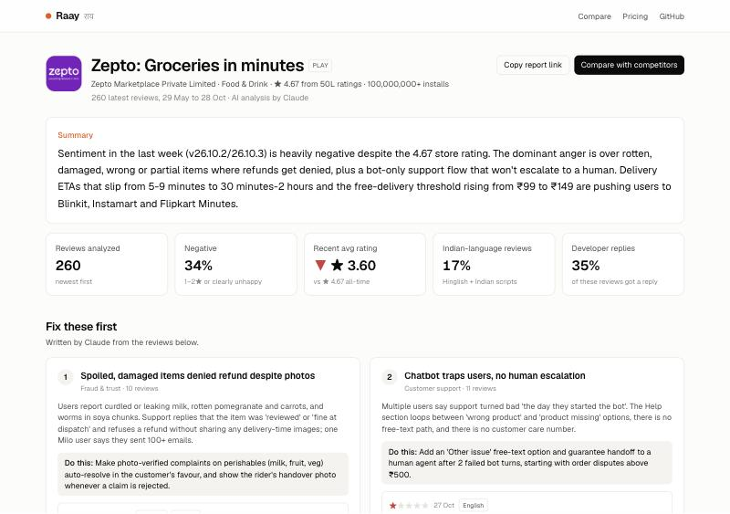
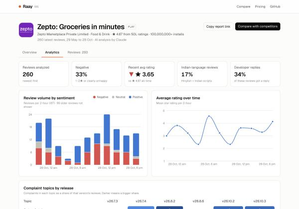
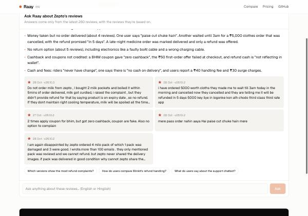

# Raay (राय)

> Your users already told you what to fix.

**App review intelligence for Indian apps.** Raay reads every Google Play and App Store review of your app and your competitors' (in English, Hinglish, Hindi, Tamil, Marathi and more) and turns them into the problems your team should fix this week. It flags bad releases and drafts replies in each user's own language.

**Live demo:** https://raay-chi.vercel.app · try [Zepto](https://raay-chi.vercel.app/app/play/com.zeptoconsumerapp) or [Zepto vs Blinkit vs BigBasket](https://raay-chi.vercel.app/compare?apps=play:com.zeptoconsumerapp,play:com.grofers.customerapp,play:com.bigbasket.mobileapp)







## Why it exists

Indian consumer apps get thousands of reviews a week, and a large share are code-mixed Hinglish or written in Indian scripts. Existing review tools are priced in dollars and built for English. Pasting reviews into a chatbot gives you a one-off answer on a sample you picked by hand.

Raay fetches the data itself, labels every review, tracks complaint rates per release, and compares you against competitors.

## Features

- **Search any app** on Google Play or the App Store (India). No login and no SDK.
- **Multilingual labelling.** Each review gets a topic (payments, delivery, login/OTP, crashes, fraud…), a sentiment, a severity, a language and a one-line English summary.
- **"Fix these first" brief** with real quotes and a concrete action for each issue.
- **Release health.** Negative-review share per app version, with automatic spike detection.
- **Reply drafts** in the reviewer's own language and script (Hinglish to Hinglish, Hindi to Hindi).
- **Competitor comparison.** A heat table of complaint mix across up to 4 apps.
- **Ask Raay (AI chat).** Ask anything about an app's reviews ("Why are people angry about refunds?") and get an answer backed by the exact reviews, plus follow-up questions.
- **Where your stars go.** A rating-impact waterfall showing how much each problem costs you in stars, and how much rating is left on the table.
- **Churn & rivals.** Spots users who say they'll uninstall or switch, and which competitors they name (Blinkit, PhonePe, Swiggy…), with the quotes.
- **Did the release fix it?** Each topic's complaint rate in the latest version vs earlier ones, with a verdict (new, getting worse, improving, gone).
- **Text analytics.** The words behind 1–2★ vs 4–5★ reviews, and what each language complains about.
- **Support & marketing.** Reply rate by star, median reply time, unanswered unhappy reviews, feature requests, and quotable 5★ reviews.
- **Share & export.** Copy a Slack digest, save the report as PDF, or download reviews as CSV.
- **Analytics dashboard.** Review volume by sentiment over time, average-rating trend, a topic-by-release heatmap, sortable topic and language tables, and sentiment split by language.
- **Reviews data table.** Search, filter by topic, language and sentiment, sort any column, and download as CSV.
- **Competitor metrics.** Sortable key-metrics table, sentiment split and complaint-mix heat table across apps.
- **Works without an API key.** A built-in English/Hinglish/Indic-script keyword classifier runs when no key is set. Claude takes over when `ANTHROPIC_API_KEY` is present.

## How it works

```
Google Play (google-play-scraper) ─┐
App Store RSS + iTunes lookup ─────┼─► fetch latest ~250 reviews (en + hi)
                                   │
                                   ▼
             ┌─────────────── Claude (structured outputs) ───────────────┐
             │ 1. label reviews in parallel chunks of 50                 │
             │    → category · sentiment · language · gist · severity    │
             │ 2. write the brief → insights · actions · reply drafts    │
             └───────── falls back to the built-in classifier ──────────┘
                                   │
                                   ▼
        stats: complaint mix · language mix · per-version spikes · trends
                                   │
                                   ▼
   cached 12h (Vercel CDN + Vercel Runtime Cache + in-memory) → Next.js report UI
```

## Tech stack

- **Next.js 16** (App Router, route handlers) + **TypeScript** + **Tailwind CSS 4**
- **Recharts** for charts, plus hand-built sortable data tables
- **Claude API** via `@anthropic-ai/sdk`: structured outputs with Zod schemas, server-side refusal fallbacks
- **google-play-scraper** and Apple's public RSS/iTunes APIs for review data
- Deployed on **Vercel**

## Run locally

```bash
npm install
cp .env.example .env.local   # add your ANTHROPIC_API_KEY (optional)
npm run dev
```

Open http://localhost:3000 and search for any app.

| Variable | Required | Purpose |
|---|---|---|
| `ANTHROPIC_API_KEY` | No | Turns on AI labelling, insights and reply drafts |
| `RAAY_MODEL` | No | Claude model ID (default `claude-opus-5-5`; `claude-haiku-5-5` is much cheaper) |
| `RAAY_LABEL_MODEL` | No | Model for bulk review labelling (defaults to `RAAY_MODEL`; `claude-haiku-5-5` cuts cost sharply) |
| `RAAY_AI_PER_IP_PER_HOUR` | No | Fresh AI analyses allowed per visitor per hour (default 5) |
| `RAAY_AI_DAILY_LIMIT` | No | Fresh AI analyses allowed per day across the whole site (default 40) |
| `RAAY_ASK_PER_IP_PER_HOUR` / `RAAY_ASK_DAILY_LIMIT` | No | Ask Raay question limits (default 15 per visitor per hour, 300 per day) |
| `RAAY_CACHE_HOURS` | No | How long an AI report is reused (default 12) |
| `NEXT_PUBLIC_CONTACT_URL` | No | Link for the "Talk to us" buttons (hidden when empty) |

## Built to handle traffic

- Pages are static and served from Vercel's CDN.
- Each app's AI report is computed once and shared by every visitor through three cache layers (CDN, Vercel Runtime Cache shared across servers and deploys, and in-memory with request de-duplication).
- Per-visitor and site-wide daily caps on paid AI calls. Past a cap, visitors get the free built-in classifier instead of an error.
- If a Claude call fails or is rate-limited, that part of the report falls back to the built-in classifier.

## Business model

| Plan | Price | Includes |
|---|---|---|
| Free | ₹0 | Any public app, latest ~250 reviews, shareable report |
| Starter | ₹2,999/mo | Your app + 3 competitors, daily refresh & history, Slack/email digest |
| Growth | ₹9,999/mo | 10 apps, spike alerts, API & CSV export, custom categories |

## Roadmap

- [ ] Accounts and saved apps (Supabase)
- [ ] Daily refresh with Vercel Cron, plus a review history database
- [ ] Slack and email weekly digest, plus spike alerts
- [ ] Razorpay subscriptions
- [ ] Public "India App Pulse" monthly report (e.g. quick-commerce complaints by category)

---

Built by [@pushpanjalishukla](https://github.com/pushpanjalishukla).
